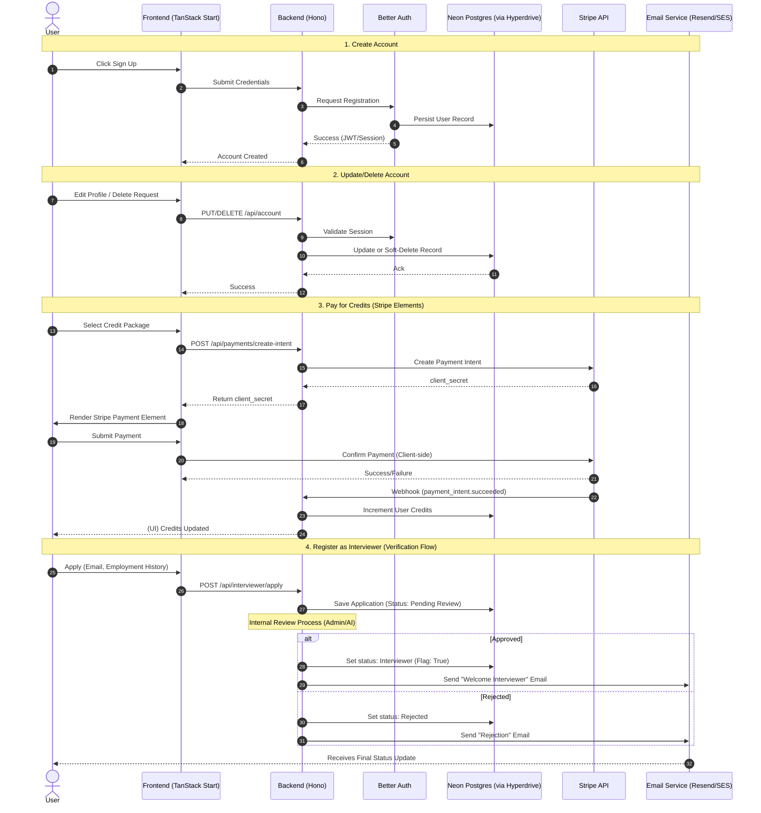

# CRUD & Account Flows

This diagram illustrates the primary user flows for account management, payments, and interviewer registration within the Mako platform.

## Flow Descriptions

1.  **Account Creation:** Authentication is done via **Better Auth**. Data is stored in **Neon** instance. 
2.  **Account Management:** Standard Hono REST endpoints protected by Auth middleware. Deletions are  "soft-deletes".
3.  **Credit Purchase:** Uses **Stripe Elements** (embedded Payment Element) for a seamless in-app checkout experience while maintaining PCI compliance. Fulfillment is handled asynchronously via **Stripe Webhooks** (`payment_intent.succeeded`) to ensure credits are granted even if the client-side confirmation is interrupted.
4.  **Interviewer Onboarding:** A multi-step process involving manual or semi-automated review. The user's application (including employment history) is held in a "Pending" state until an approval decision triggers the "Interviewer" flag update and a confirmation email.
