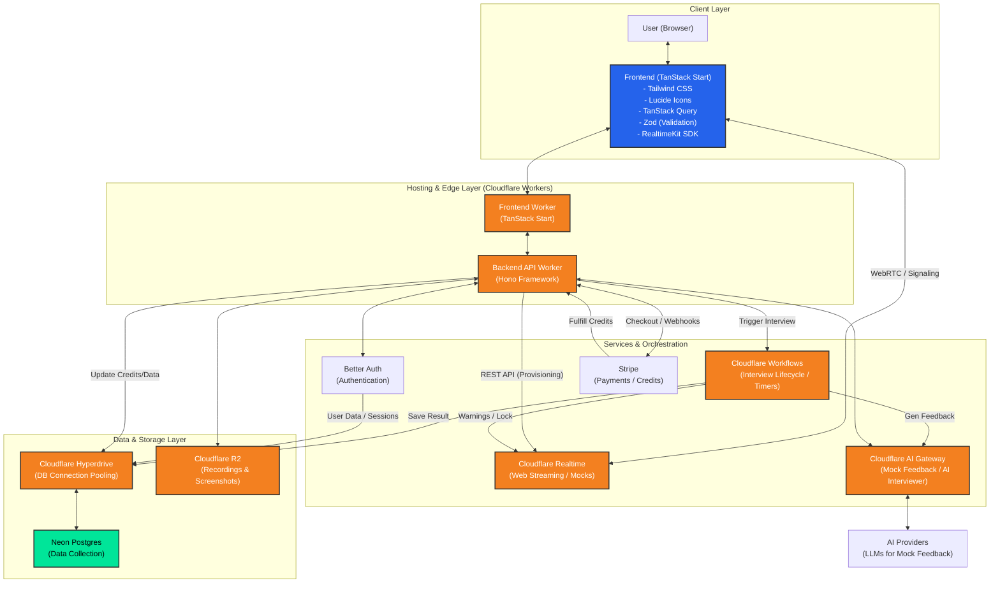

# Mako System Architecture

This diagram illustrates the high-level architecture of the Mako SWE interview platform, highlighting the integration of Cloudflare services, AI components, and the frontend/backend stack.

## Key Components

- **Frontend:** Built with TanStack Start, hosted on Cloudflare Workers for edge performance.
- **Backend API:** Uses Hono for routing within Cloudflare Workers, ensuring low latency.
- **Database:** Postgres hosted on Neon, optimized for serverless environments with Cloudflare Hyperdrive.
- **AI Integration:** Cloudflare AI Gateway manages requests to AI providers for real-time interview feedback and the AI interviewer functionality.
- **Real-time:** Cloudflare Realtime handles the live streaming required for mock interviews between users.
- **Storage:** Cloudflare R2 stores session recordings and any captured screenshots for review.
